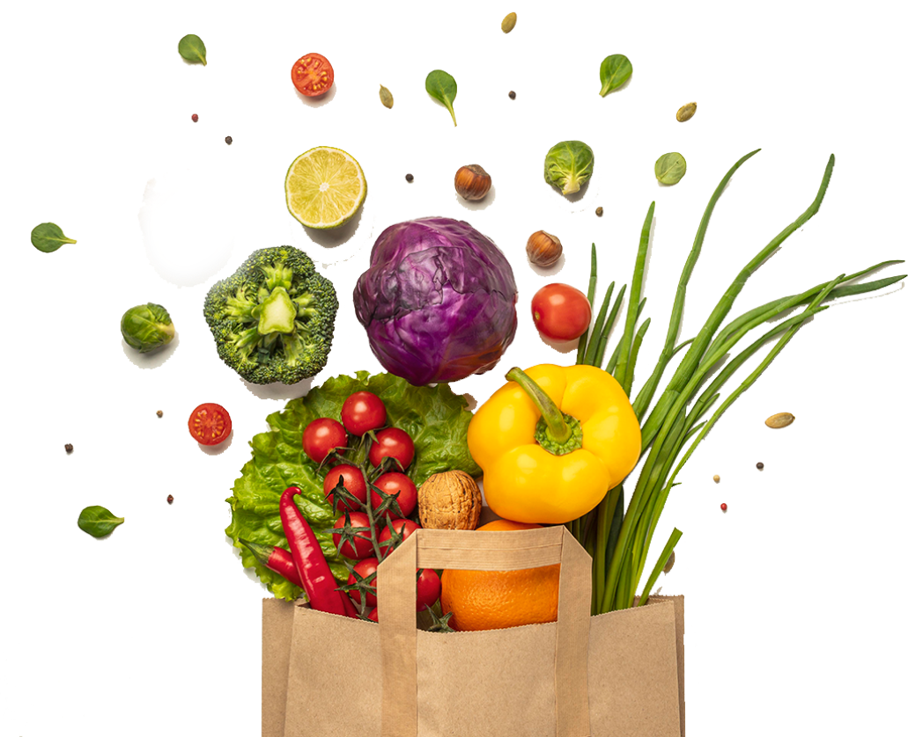

# 🥦 Living Lab — Fresh Grocery & Organic Market



A modern, responsive, and interactive farm-to-table organic grocery web application built with **HTML5**, **Tailwind CSS**, **DaisyUI**, and **Vanilla JavaScript (ES6+)**.

---

## ✨ Features

- 🌿 **Google Fonts (Poppins)**: Clean, high-legibility typography across all headings, cards, badges, and buttons.
- 🛍️ **Interactive Grocery Shopping Cart (Slide-Over Drawer)**:
  - Add items with instant badge count updates and toast notifications.
  - Stepper controls (`+` / `-`) for item quantities and individual item deletion.
  - Subtotal calculation with free delivery threshold (Free over $25).
  - Built-in coupon engine with instant discount validation (try code **`FRESH20`** for 20% off).
  - Saved in `localStorage` so items persist across page refreshes.
- 🔍 **Live Search & Category Filtering**:
  - Search filter across all produce (onions, tomatoes, potatoes, basmati rice, etc.).
  - Category tabs: **All Items**, **Vegetables**, **Rice & Grains**, and **Combo Baskets**.
  - Sorting options: Price (Low to High, High to Low) and Top Rated.
- 👁️ **Quick View Modal (<dialog>)**:
  - Powered by native `<dialog closedby="any">` with fallback for older browsers.
  - High-res product preview, description, ratings, review count, and one-click add to cart.
- ❤️ **Saved Wishlist**:
  - Save favorite organic produce items with heart buttons and move them to cart anytime.
- ⏱️ **Flash Deals Countdown**:
  - Live ticking timer for promotional flash arrivals.
- 🚚 **Express 30-Min Checkout Flow**:
  - Shipping address and preferred time slot selection (Express 30-min, Morning, Evening).
  - Payment options (Cash on Delivery, bKash, Card).
  - Confirmed Order ID generation (`#LL-XXXXXX`) and receipt screen.
- 🔐 **Interactive Auth Modal**:
  - Tabbed modal for Login and Registration.
- 📬 **Newsletter Subscription**:
  - Instant client-side email validation with promo reward alert.
- 📱 **Mobile-First Responsive Design**:
  - Optimized for mobile phones, tablets, and desktop viewports with responsive navigation drawer.

---

## 🛠️ Tech Stack

- **Markup**: HTML5 (Semantic tags, `<dialog>`, `<details>`, `<summary>`)
- **Styling**: [Tailwind CSS 3](https://tailwindcss.com/) & [DaisyUI 4](https://daisyui.com/)
- **Typography**: [Google Fonts (Poppins)](https://fonts.google.com/specimen/Poppins)
- **Icons**: [Font Awesome 6](https://fontawesome.com/)
- **Scripting**: Vanilla JavaScript (ES6+, LocalStorage, Event Handling)

---

## 📂 Project Structure

```text
Living_lab/
├── c2-assets/                  # Brand logos, mockups & produce photography
│   ├── dawat-logo.png
│   ├── dawat-mock-up.png
│   ├── delivery.png
│   ├── healthy.png
│   ├── hero-vegetables.png
│   ├── india-gate-logo.png
│   ├── india-gate-mock-up.png
│   ├── logo-footer.png
│   ├── logo-header.png
│   ├── onion.png
│   ├── potato.png
│   ├── service.png
│   ├── tomato.png
│   ├── vegetable-busket.png
│   └── vegetable-offer.png
├── script/
│   └── main.js                 # Cart state, search, filters & checkout logic
├── index.html                  # Core application structure & landing page
├── style.css                   # Custom typography, animations & modal backdrops
├── tailwind.config.js          # Tailwind configuration
└── README.md                   # Documentation
```

---

## 🚀 How to Run

Open `index.html` directly in your browser, or start a local server:

```powershell
cd C:\Users\Sojib\.gemini\antigravity\scratch\Living_lab
python -m http.server 4000
```
Then visit `http://localhost:4000` in your web browser.

---

## 🎟️ Active Promo Codes

| Code | Discount | Terms |
| ---- | -------- | ----- |
| `FRESH20` | **20% OFF** | Applicable to entire grocery subtotal |
| `ORGANIC` | **15% OFF** | Organic produce discount |

---

&copy; 2026 Living Lab & Nature's Platter. All rights reserved.
